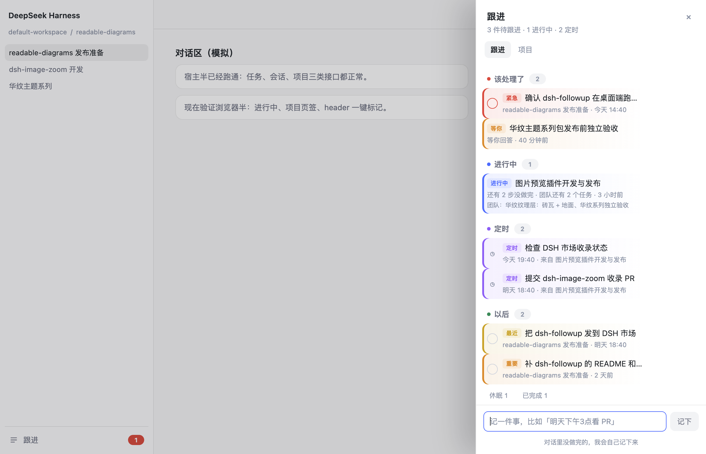
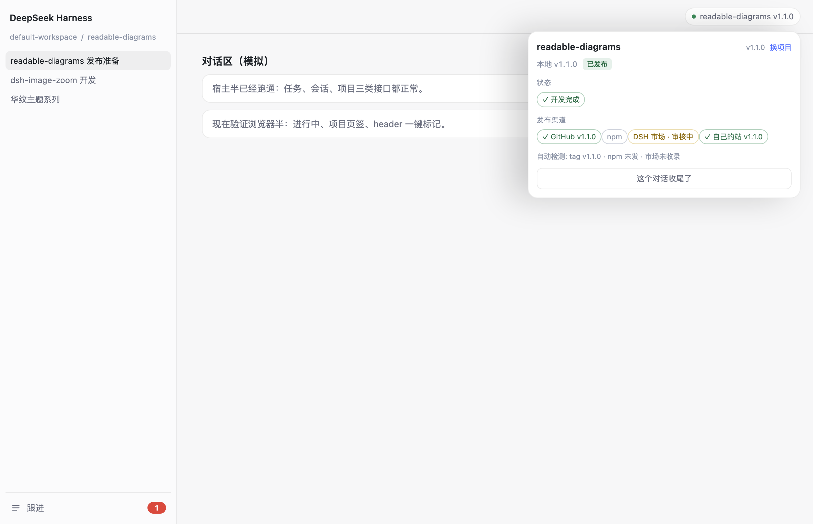
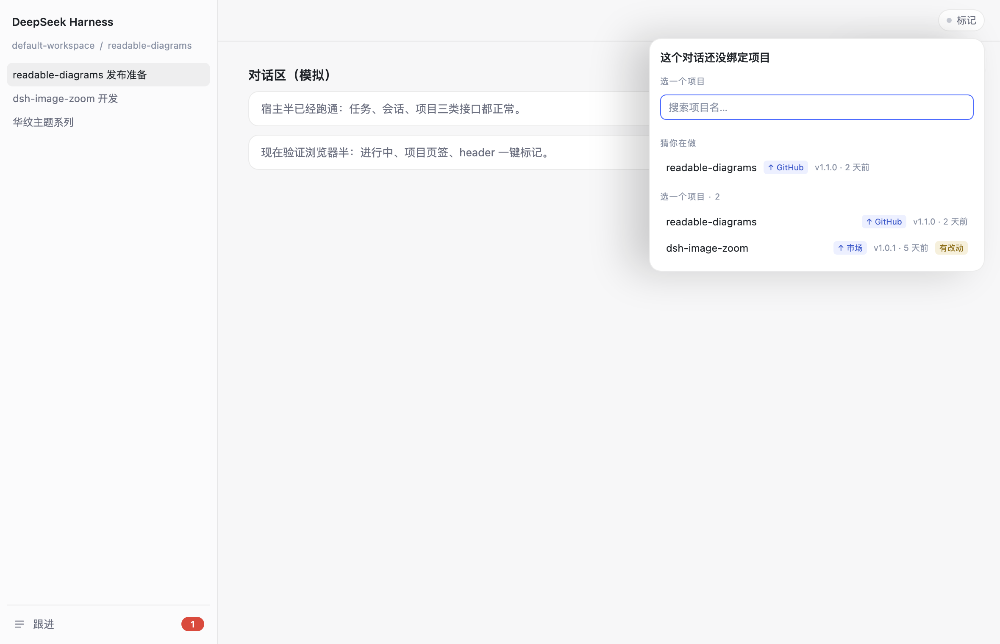

# dsh-followup · Follow-up

> Unfinished things from any conversation are recorded for you, surface on time, and one click takes you back to the conversation where they were born.
>
> No settings, no projects, no priorities to configure — just one list.



## What it solves

| Before | After |
|---|---|
| You switch tasks mid-chat and forget what you were doing | The left-sidebar "Follow-up" keeps it; click to jump back |
| You tell yourself "check the PR tomorrow" and forget | Say it, it is recorded; it turns red when due |
| Several projects, tasks scattered across TASKS.md and chats | One list across everything; no project picker first |

## How it works

- **One-click marking in the conversation header**: bind the conversation to a project, mark dev-done, mark release channels (GitHub / npm / DSH Market / your own site), mark the market submission as "in review", or close the conversation.
- **Projects tab**: discovers folders with `package.json` / `.git`, shows version, channels, last commit, uncommitted changes.
- **In progress**: conversations with unfinished work, one row per conversation; close or ignore.
- **Scheduled**: active entries from `schedule.json`, click to jump back to the source conversation.
- **Sticky-note colours**: red = overdue/urgent, orange = today/waiting/important, yellow = soon, blue = in progress, purple = scheduled, green = todo, grey = dormant/done. Each task row has a hover flag to cycle priority (auto → important → urgent).





## Time parsing

Natural-language time is accepted when adding a task:

```
tomorrow at 3pm · Friday · in 3 days · 2026-11-03 10:00
```

## Data

```
~/.dsh/followup/tasks.json      # follow-up items
~/.dsh/followup/projects.json   # project facts cache, marks, conversation bindings
```

Local only. No account, no token, no sync. Delete the folder to reset. No conversation content is stored.

## Agent tools

| Tool | Purpose |
|---|---|
| `followup_add` | Record an item (`title`, optional `due`, `note`, `priority`) |
| `followup_list` | List open items (and ids) |
| `followup_done` | Close an item |

A system-prompt section teaches every agent to record things when the user says "remind me / note this / later", or when a turn ends with unfinished work.

## Install

```bash
# from npm (after the first publish)
dsh plugin --profile web add @bingomu/dsh-followup

# or directly from GitHub
dsh plugin --profile web add github:bingomu/dsh-followup
```

Desktop app: Settings → Plugins. Restart the app once after installing (the host half mounts at boot). The client half reloads with the page.

Local development uses a link in the profile's `dependencies` + `bundles`, then a restart.

## Development

```bash
node tests/run.mjs   # dates, store, tools, routes, projects, sessions, schedules — 48 checks
```

## Boundaries

- Reminders only appear while DSH is running.
- Auto-recording depends on the agent following the system prompt; you can always add an item manually.
- Project discovery scans the workspace root and its direct children.
- Automatic release detection uses local git tags, the npm registry and the DSH Marketplace page; uncommitted local changes are shown separately.

## License

MIT
