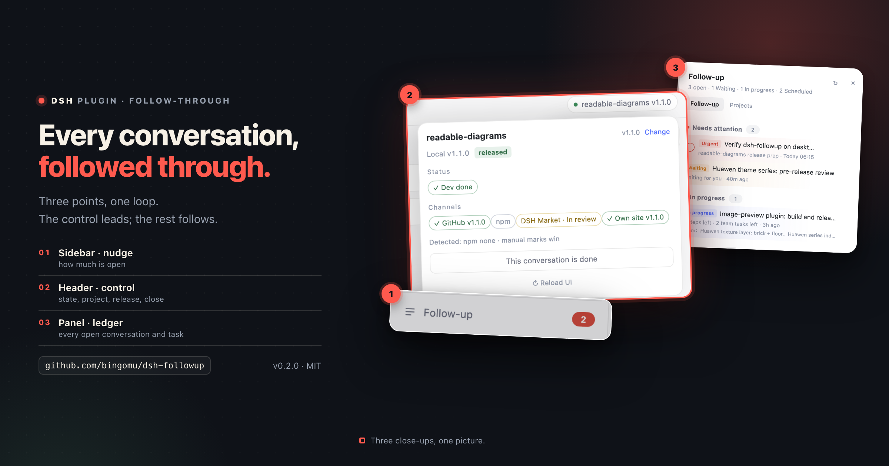
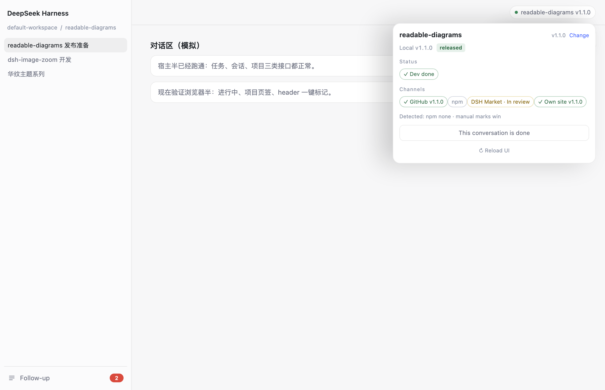
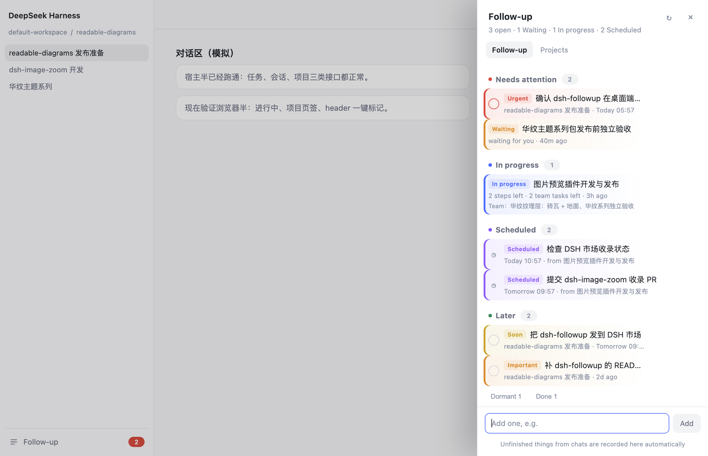
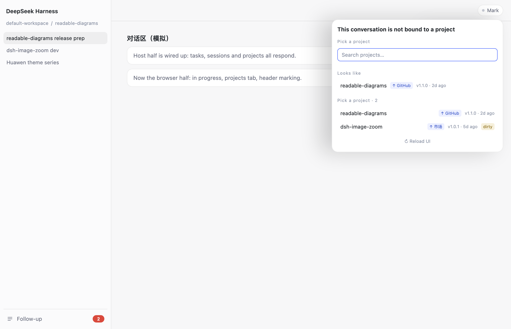

# dsh-followup · Follow-up

> **You opened twelve conversations. Not one of them is closed.**
>
> This plugin covers the stretch between starting something and finishing it: mark state in the conversation header, see what is still open in the sidebar, and read the ledger of every open item in the right panel.

[中文](README.md)




## Positioning

AI multiplies chats, projects and tasks, and fragments attention. Plenty of starts — a PR, a release, an "I'll come back to that" — and very few endings. This connects the start to the ending, in three layers:

| Layer | Where | What |
|---|---|---|
| **Control (core)** | top-right of every conversation | mark dev-done, release channel, version, market review, and whether the conversation is done |
| **Nudge** | left sidebar “Follow-up” | the entry plus a count of what needs attention |
| **Ledger** | right panel | every unfinished conversation, task, schedule and project, sorted by state — the result |

One line: **mark in the chat → align with the project → close in the list.**

**All three points together are the product.**

The left sidebar is the entry, not the console; the right panel is the result, not the main interface. The control surface is the conversation header.





## What it solves

| Before | After |
|---|---|
| You switch tasks mid-chat and forget what you were doing | The left-sidebar "Follow-up" keeps it; click to jump back |
| You tell yourself "check the PR tomorrow" and forget | Say it, it is recorded; it turns red when due |
| Several projects, tasks scattered across TASKS.md and chats | One list across everything; no project picker first |

## How it works

- **Control in the conversation header**: bind a project, mark dev-done, GitHub / npm / DSH Market / your own site (market has `in review`), see local vs published version, and close the conversation.
- **Projects tab**: discovers folders with `package.json` / `.git`, shows version, channels, last commit and uncommitted changes.
- **In progress**: conversations with unfinished work from DSH's own signals, one row per conversation; you can close or ignore them.
- **Scheduled**: active entries from `schedule.json`, click to jump back to the source conversation.
- **Sticky-note colours**: red = overdue/urgent, orange = today/waiting/important, yellow = soon, blue = in progress, purple = scheduled, green = todo, grey = dormant/done. Each task row has a hover flag to cycle priority (auto → important → urgent).



## Time parsing

Natural-language time is accepted when adding a task:

```
tomorrow at 3pm · Friday · in 3 days · 2026-11-03 10:00
```

## Data

```
~/.dsh/followup/tasks.json      # follow-up items
~/.dsh/followup/projects.json   # project facts cache, marks, conversation bindings
```

Local only. No account, no token, no sync. Delete the folder to reset. No conversation content is stored.

## Agent tools

| Tool | Purpose |
|---|---|
| `followup_add` | Record an item (`title`, optional `due`, `note`, `priority`) |
| `followup_list` | List open items (and ids) |
| `followup_done` | Close an item |

A system-prompt section teaches every agent to record things when the user says "remind me / note this / later", or when a turn ends with unfinished work.

## Install

### From the GitHub release (recommended; no npm needed)

**Quit the desktop app fully first** (`⌘Q`; closing the window is not enough), then:

```bash
"/Applications/DeepSeek Harness.app/Contents/Resources/runtime/cli/bin/dsh" \
  plugin --profile desktop add \
  "https://github.com/bingomu/dsh-followup/releases/download/v0.2.2/bingomu-dsh-followup-0.2.2.tgz"
```

Reopen the app.

- For `dsh web`, use `--profile web` instead of `--profile desktop`
- You can also download `bingomu-dsh-followup-0.2.2.tgz` from the
  [release page](https://github.com/bingomu/dsh-followup/releases/tag/v0.2.2) and install with `file:/absolute/path`
- Full walkthrough (finding the CLI, PATH, troubleshooting, uninstall): [docs/install-from-release.md](docs/install-from-release.md)

### From source

```bash
dsh plugin --profile desktop add github:bingomu/dsh-followup
```

### npm

Not published yet; once it is, `dsh plugin add @bingomu/dsh-followup` will work.
Until then, install from the GitHub release tarball.

### Uninstall

```bash
dsh plugin --profile desktop remove @bingomu/dsh-followup
```

Data stays in `~/.dsh/followup/`.

Local development uses a link in the profile's `dependencies` + `bundles`, then a restart.

## Development

```bash
node tests/run.mjs   # dates, store, tools, routes, projects, sessions, schedules — 48 checks
```

## Boundaries

- Reminders only appear while DSH is running.
- Auto-recording depends on the agent following the system prompt; you can always add an item manually.
- Project discovery scans the workspace root and its direct children.
- Automatic release detection uses local git tags, the npm registry and the DSH Marketplace page; uncommitted local changes are shown separately.

## Support this project

If it saved you time, you can buy me a coffee. Sponsorship does not unlock features and there is no paywall.

- Afdian: https://ifdian.net/a/genzo99
- Sponsors: [SPONSORS.md](SPONSORS.md)

## License

MIT
