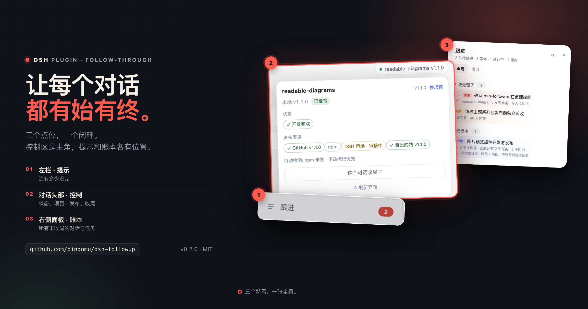
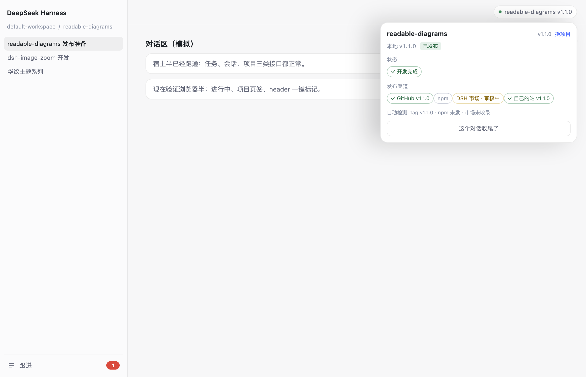
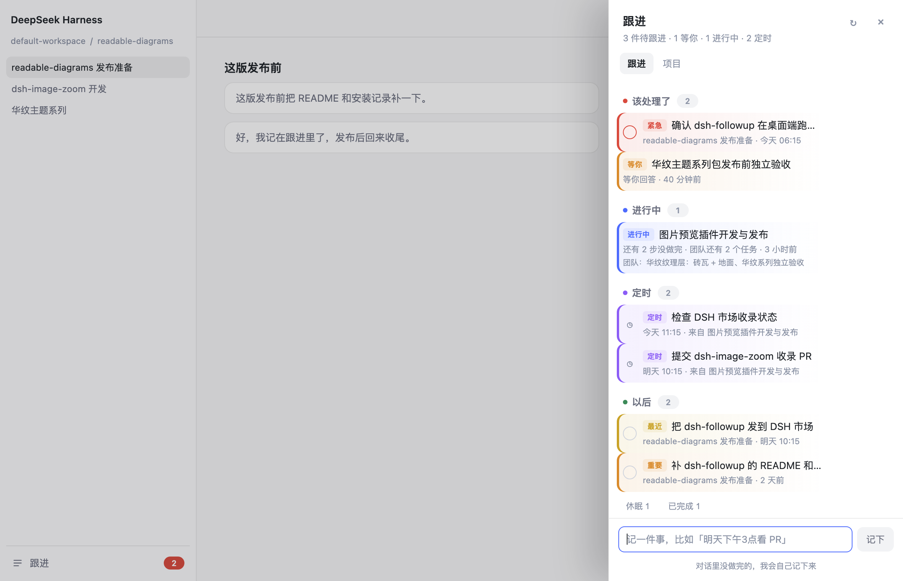
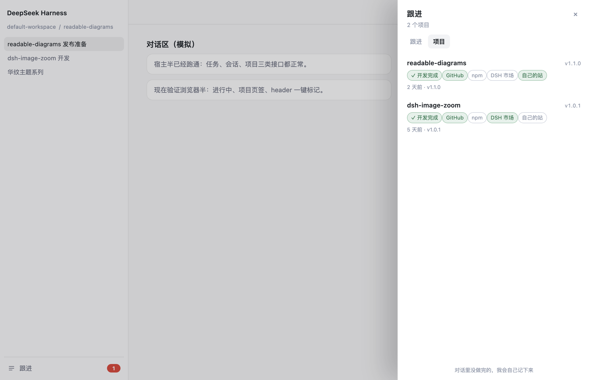

# dsh-followup · 跟进


[](LICENSE)
[](https://github.com/bingomu/dsh-followup)

> **你开了 12 个对话，没有一个是收尾的。**
>
> 这个插件补的是「开始」和「收尾」之间最容易断的那一段：对话右上角标记状态，左栏提醒还没完的事，右侧面板是所有这些事的账本。

[English](README.en.md)




## 产品定位

AI 让对话、项目、任务的数量爆炸，注意力被切碎。头开得很多：一个 PR、一次发布、一句「回头再说」；能走到收尾的很少。

这个插件把「开始」和「收尾」接上，分三层：

| 层 | 在哪 | 做什么 |
|---|---|---|
| **控制区（核心）** | 每个对话右上角 | 标记开发完成、发布渠道、版本、市场审核中，决定这个对话是否收尾 |
| **提示** | 左栏底部「跟进」 | 入口 + 该处理的数字，扫一眼就知道还有多少没完 |
| **账本** | 右侧面板 | 所有未收尾的对话、任务、定时、项目，按状态排好——结果 |

一条主线：**对话里标记 → 项目里对齐 → 清单里收尾**。

**三个点位一起，才是整体。**

左栏是入口，不是操作台；右侧面板是结果，不是主界面。真正在过程中用的是对话右上角那块控制区。







## 它解决什么

| 以前 | 现在 |
|---|---|
| 聊到一半转去别的事，回来已经忘了当时还要干嘛 | 左栏底部的「跟进」里躺着那件事，点一下直接回到那个对话 |
| 答应自己「明天看」的 PR / 发布 / 拍板，第二天完全不记得 | 说了「提醒我」就记下；到点右下角浮一条轻提示，面板里变红置顶 |
| 同时开好几个项目，待办散在各自的 TASKS.md 和对话里 | 一条清单管全部，不用先选项目 |

## 便签纸配色

每条任务/对话/定时都按轻重缓急上色：左边一条色条 + 淡色便签底 + 小标签。

| 颜色 | 含义 |
|---|---|
| 红 | 逾期 / 手动标了「紧急」 |
| 橙 | 今天到期 / 等你回答 / 手动标了「重要」 |
| 黄 | 最近三天 |
| 蓝 | 进行中（有未收尾信号的对话） |
| 紫 | 定时任务 |
| 绿 | 待办（没有期限） |
| 灰 | 休眠 / 已完成 |

任务行悬停会出现一个 **⚑**：点一下在「自动 → 重要 → 紧急 → 自动」之间循环，选择会保存。
你也可以直接对 agent 说「这件事很重要 / 很急」，它写进清单时会带上优先级。

## 三层界面

1. **控制区（核心）**：每个对话右上角的小标签和浮层。标记开发完成、发布渠道、版本、市场审核中，决定这个对话收尾；项目名、版本、是否绑对都在这。
2. **提示**：左栏底部「跟进」+ 数字（数字 = 该处理的数量）。它只负责让你知道有多少没完，点开进入账本。
3. **账本**：右侧面板，两个页签。
   - **跟进**：该处理了（到期任务 + 等你回答的对话）→ 进行中（自动收的未收尾对话，带团队任务明细）→ 定时（还活着的定时任务）→ 以后 → 已完成
   - **项目**：工作区里每个项目的版本、发布渠道、最近活动

到点/搁置时，右上角还会浮一条「N 件该处理了 · 看看」，8 秒自己走，点它进面板（每次页面加载最多一条）。

每行：任务点圆圈完成 / 点正文回到原对话；对话行点一下直接跳回去。

## 对话头部：控制区（核心）

对话右上角有一个小标签，显示这个对话绑定的项目和版本，点开是一键标记：

- **开发完成**：这一版做完了
- **发布渠道**：GitHub / npm / DSH 市场 / 自己的站，点一下切换
- **自动检测**：tag、npm 最新版、市场是否收录，显示成一行灰字，不用你填
- **这个对话收尾了**：标记后它从「进行中」消失；也能恢复
- **换项目**：cwd 或标题匹配不上时才出现。带搜索框，输入几个字就过滤；列表按「和这个对话的匹配度」排序，最像的会单独摆在「猜你在做」里；每行右边依次是 `最近发布渠道`、`版本 · 最近活跃`、`有改动`：
`readable-diagrams  ↑ GitHub  v1.1.0 · 2 天前`、`dsh-image-zoom  ↑ 市场  v1.0.1 · 5 天前  有改动`
发布渠道取你手动标记里最近点亮的那个（按时间），没有标记时用 tag / npm / 市场收录兜底。；输入完按回车选第一个

标记按版本记：`v1.1.0` 的发布状态不会串到 `v1.1.1`。版本号从 `package.json` 自动读，不用输。

底部还有一个输入框，想手动记一条就写一句，回车保存。也认人话时间：

```
明天下午3点看 PR
周五交稿
3天后问一下进度
2026-11-03 10:00 发布 v1.1.0
```

## 数据在哪

```
~/.dsh/followup/tasks.json      # 跟进清单
~/.dsh/followup/projects.json   # 项目事实缓存、标记、对话绑定与收尾
```

两个 JSON 文件，本地、无同步、无 token。删掉就是清空。不存对话内容。

## 给 agent 的工具

| 工具 | 作用 |
|---|---|
| `followup_add` | 记一条（title 必填，due 自然语言，note 可选） |
| `followup_list` | 查清单（拿 id） |
| `followup_done` | 关一条 |

宿主半同时注册了 `GET /followup/list`、`POST /followup/add|update|remove`，浏览器半只走这四个口。

## 安装 / 卸载

### 从 GitHub Release（推荐，不需要 npm）

**先 ⌘Q 完全退出桌面 App**（点红叉关窗口不算），然后：

```bash
"/Applications/DeepSeek Harness.app/Contents/Resources/runtime/cli/bin/dsh" \
  plugin --profile desktop add \
  "https://github.com/bingomu/dsh-followup/releases/download/v0.2.1/bingomu-dsh-followup-0.2.1.tgz"
```

重新打开 App。

- 网页版把 `--profile desktop` 换成 `--profile web`
- 也可以从 [Release 页面](https://github.com/bingomu/dsh-followup/releases/tag/v0.2.1) 下载
  `bingomu-dsh-followup-0.2.1.tgz`，再用 `file:/绝对路径` 安装
- 完整步骤（找 CLI、PATH、排错、卸载）：[docs/install-from-release.md](docs/install-from-release.md)

### 从源码

```bash
dsh plugin --profile desktop add github:bingomu/dsh-followup
```

### npm

暂未发布；发布后会补 `dsh plugin add @bingomu/dsh-followup`。
现在市场/README 的安装都走 GitHub Release 的 tarball。

### 卸载

```bash
dsh plugin --profile desktop remove @bingomu/dsh-followup
```

数据保留在 `~/.dsh/followup/`，删目录才会清空。

本地开发态用 profile 的 `link:`：

```jsonc
"dependencies": { "@bingomu/dsh-followup": "link:/path/to/dsh-followup" }
"dsh": { "profile": { "bundles": [ ..., "@bingomu/dsh-followup" ] } }
```

## 开发自检

```bash
node tests/run.mjs          # 日期 / 存储 / 工具 / 路由 / 项目 / 会话，48 项
```

UI 单看（不需要装进 App，`mode` 可选 sheet / projects / header）：

```bash
"/Applications/Google Chrome.app/Contents/MacOS/Google Chrome" \
  --headless=new --no-sandbox --disable-gpu --hide-scrollbars \
  --window-size=1180,760 --virtual-time-budget=7000 \
  --screenshot=tests/shots/sheet.png "file://$PWD/tests/harness.html?mode=sheet"
```

## 已知边界

- 提醒只在 DSH 开着的时候出现；App 关了不推送（本地插件没有后台进程）。
- 一个清单，不按项目分组——因为项目名你已经能从每行的来源看出来。
- 不跨设备同步。
- 自动记录依赖 agent 遵守系统提示；它没记的，你可以手动补一句。

## 支持这个项目

如果它帮你省了时间，可以请我喝杯咖啡。赞助不影响功能，也不会有付费墙。

- 爱发电：https://ifdian.net/a/genzo99
- 赞助者名单：[SPONSORS.md](SPONSORS.md)
